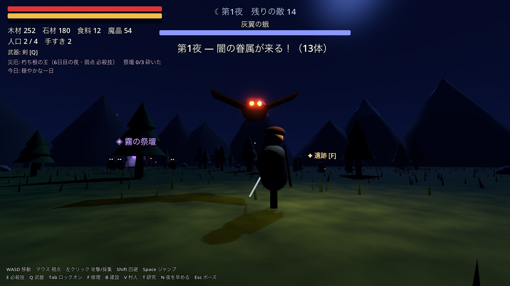
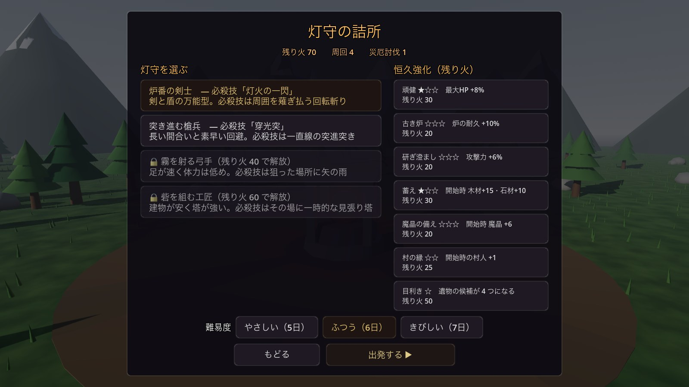
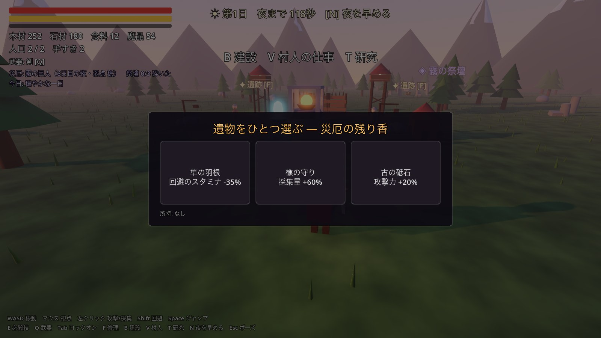
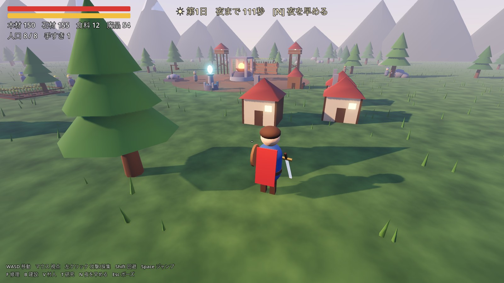

# 灯守の砦 Hearthwarden

昼は拠点を築き、夜は灯火を守り抜く 3D アクション × 拠点経営の周回型（ローグライト）ゲーム。
1 周 5〜7 日。毎回違う「災厄（ボス）」・マップ・遺物・出来事に挑み、最後の夜に災厄を討て。

## ▶ [ブラウザで遊ぶ](https://shinkaba.github.io/hearthwarden-play/)

インストール不要。パソコンの Chrome / Edge / Firefox / Safari で動きます（スマホ非対応）。
初回は読み込みに少し時間がかかります（約 40MB）。

| 灯守の詰所 | 遺物の 3 択 | 村 |
|---|---|---|
|  |  |  |

## 操作

| 操作 | キー |
|---|---|
| 移動 / 視点 | WASD / マウス（画面をクリックすると視点操作が始まります） |
| 攻撃・採集 | 左クリック |
| 回避 / ジャンプ | Shift / Space |
| 必殺技 / 武器切替 / ロックオン | E / Q / Tab |
| 修理・調べる | F |
| 建設モード | B（数字で選択、R 回転、U 強化、X 解体） |
| 村人の仕事 / 研究 | V / T |
| 夜を早める | N |
| ポーズ | Esc（ブラウザではマウスの固定も解除されます。もう一度クリックで再開） |

## 遊び方

- 灯火の炉を守りながら日を重ね、最後の夜に来る「災厄」を倒せば勝利。炉が壊されたら敗北
- 昼は木や岩を叩いて資源を集め、建物を建て、村人に仕事を任せる
- 拠点の外の「霧の祭壇」を砕くほど災厄は弱る。遺跡や流星からは遺物が手に入る
- 周が終わると「残り火」がもらえる。タイトルの「灯守の詰所」で新しい灯守の解放や恒久強化に使える
- 進行はブラウザに保存されます（夜明けに自動セーブ）

## このリポジトリについて

ここにはブラウザ版の**ビルド成果物のみ**を置いています（ソースコードは非公開）。
感想・不具合の報告は [Issues](https://github.com/Shinkaba/hearthwarden-play/issues) へどうぞ。

- エンジン: [Godot Engine](https://godotengine.org/) 4.7（MIT License、[GODOT_LICENSE.txt](GODOT_LICENSE.txt)）
- フォント: [Noto Sans JP](https://fonts.google.com/noto/specimen/Noto+Sans+JP)（SIL Open Font License 1.1、[FONT_LICENSE.txt](FONT_LICENSE.txt)）
- 効果音・BGM・3D モデルはすべてゲーム内で手続き生成したものです
